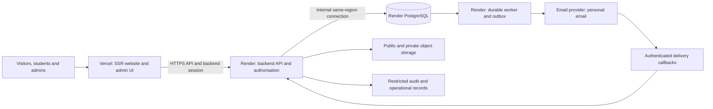

# SEES Website and Member Platform

**Product requirements document | Draft v1.2 | 24 October 2026**

**Product owner:** SEES UNILAG, represented by its designated Executive Council leads.  
**Delivery team:** SEES Tech Hub development team.  
**Project:** A new Society-owned website and member platform, separate from the SEES Tech Hub application and Testbench.  
**Status:** Initial implementation in progress; see BUILD_STATUS.md for delivered scope and launch gaps. Proposed defaults below are recommendations, not recorded Council approvals. This document does not authorise deployment, data imports or external account creation.

## 1. Product direction

Build the official digital home of SEES UNILAG: a welcoming public website, useful academic resources, student accounts and a newsletter, supported by an admin workspace that the next executive team can inherit. Public naming and visual identity follow the supplied SEES brand guide, which uses Society of Electrical/Electronics and Computer Engineering Students. Registration distinguishes format-based eligibility from independently confirmed student identity.

The public experience should feel like a focused Society website. A visitor should immediately understand who SEES represents, see its current leadership and activities, and find resources, announcements and contact information. The deeper platform should appear when students need protected resources or when the content team needs to publish and manage information.

The rebuild includes the public site, membership system, resource library, newsletter, content management, administrative workflows, audit records and operational handover. These are planned together from the beginning, although released in stages. The public site must not depend on RADAR being ready.

### Source authority and unresolved requirements

The user's request establishes the rebuild and ownership goals. The supplied PDFs and HTML prototype are stakeholder input. Their instructions are requirements to evaluate, not permission to create accounts, contact people, import personal data or publish anything. Where source documents disagree, this PRD states a proposed resolution or an explicit decision to make.

| Source | What it contributes | How it is used |
| --- | --- | --- |
| User direction, 24 October 2026 | Start from scratch; own repositories, logins and deployments; plan landing page, newsletter, accounts and admin operations together | Primary product direction |
| User clarification, 24 October 2026 | Monorepo; Vercel frontend; Render backend/database; matric eligibility format and year allowlist; no official-student-email dependency; password recovery | Confirmed constraints; Express with TypeScript and managed Render Postgres subsequently confirmed by the user |
| `SEES BRAND GUIDE.pdf`, 10 pages | Approved logo variants, Oswald/Inter typography and mint/green palette | Authoritative visual baseline, inspected visually because its pages are image-based |
| Akeem's supplied message | New executives' names and photographs, President's address, SEES subbodies, updated resources; creative freedom for the website | Required launch content and design brief |
| `SEES Platform Newsletter and SEESites Member Accounts (Spec v1).pdf`, 14 pages | Membership, publishing, resources, roles, email, security and phased delivery | Main expansion brief; gaps and contradictions resolved explicitly below |
| `RADAR-Developer-Specification.pdf`, 8 pages | Searchable opportunities, editorial management, device-local application status | Conditional module; deployment location remains undecided |
| `sees-opportunity-tracker (1).html` | Standalone reference prototype with sample opportunity data | Behaviour reference, not production data or a prescribed implementation |
| Local `Desktop/code-projects/sees_website` checkout | Existing identity, navigation, asset inventory and content layout | Inspiration and content audit; no obligation to preserve its architecture |

The local website is a React/Vite application with routes for Home, Events, Executives, Teams and Resources, green branding and Manrope typography. Its executive and event content includes placeholders; level resources link to placeholders. Its newsletter form calls `https://sees-api.onrender.com/subscribers/`. The local origin is `https://github.com/davistar21/sees-website.git`, and the latest local commit inspected is `0b0784d`, dated 1 November 2025. This is a local-source observation, not a production or ownership audit. No pull, remote changes, subscriber API calls or deployment inspection were performed. That endpoint's ownership, data and availability are unverified.

## 2. Outcomes and boundaries

### Intended outcomes

1. Present an accurate, polished Society identity and current executive session.
2. Make approved academic resources easy to find on a phone.
3. Establish a private member register with explicit eligibility/proof status, accessible only to authorised administrators. Do not equate self-registration with a verified departmental roster.
4. Give the content team a permanent, searchable publishing home with dependable subscription email.
5. Let authorised staff update content and resources without code changes.
6. Make sensitive actions accountable and executive handover repeatable.
7. Keep source, infrastructure, data and recovery access under Society control.

### Scope by release

| Release | Included | Exit condition |
| --- | --- | --- |
| R0: Foundation | Ownership register, content inventory, design system, infrastructure plan, schema/access design and decision register | Required owners and launch policies identified; implementation plan can be estimated |
| R1: Public website and content operations | Landing page, leadership, President's address, subbodies, events, contact, general resources, admin authentication, content/media publishing and audit foundation | Society can maintain accurate public content without a developer |
| R2: Member platform | Matric-format validation, personal-email verification, registration, login and forgot-password at launch, member resources, optional profiles, student management, roster reconciliation, exports, deletion and academic-session progression | Format-eligible members can activate using verified personal email; evidence status remains visible to admins; recovery and the full account lifecycle work |
| R3: Newsletter | Rich publishing, archive/search, members-only reading, subscription, scheduling and durable email delivery | Publishing and delivery are independently reliable and permission-safe |
| Conditional: RADAR | Either integrated module or linked standalone product, after placement decision | Separate acceptance gate; never blocks R1-R3 |

The architecture and data design for R2-R3 are part of R0, even if the initial public release precedes them. Once R3 launches, the complete first-version platform is available. A public release alone must not be described as the completed member/newsletter platform.

### Outside the initial releases

Payments/dues, university-portal integration, public member directories, direct messaging, student file submissions, newsletter comments, a mobile app, automated opportunity scraping and a full learning management system. Huawei/Testbench work remains paused and separate. No cross-product shared login or database is implied.

## 3. Users, roles and ownership

### Access model

Membership and administrative authority are separate. Being President, a content author or a registered student does not automatically grant technical access. An executive's public profile is a content record, not an admin account.

| Capability | Visitor / subscriber | Active member | Editor | Super Admin |
| --- | --- | --- | --- | --- |
| Read public site, public posts and general resources | Yes | Yes | Yes | Yes |
| Subscribe to public newsletter | After email confirmation | Optional opt-in | As a subscriber | As a subscriber |
| Read protected posts and level resources | No | Yes, under membership policy | Preview/manage through admin permission | Yes |
| Edit own member profile/settings | No | Own account only | Only if separately a member | Only if separately a member |
| Manage pages, executives, subbodies, events, resources and media | No | No | Yes | Yes |
| Publish/schedule posts and initiate email campaigns | No | No | Yes, with explicit send confirmation | Yes |
| See newsletter delivery summaries | No | No | Aggregates and masked diagnostics | Yes |
| View roster, student records, biodata, approvals and exports | No | No | No | Yes; sensitive access recorded |
| Manage admin roles, academic sessions and audit records | No | No | No | Yes, within the safeguards below |
| Read passwords, reset tokens or authentication secrets | No | No | No | No |

Alumni are a separate membership state with access controlled by an explicit policy. Proposed launch default: public resources/posts remain available; protected student access ends on graduation unless Council approves alumni access. Deactivated, rejected and deletion-pending accounts never retain protected access.

### Society ownership requirements

**OWN-01.** New repositories belong to a Society-controlled organisation with at least two named maintainers. Each contributor uses their own account. No shared personal passwords or dependence on one student's email address.

**OWN-02.** Record the owner, billing/recovery contacts and access level for domain registration, DNS, code organisation, hosting, database, object storage, email, monitoring, backups and secret storage. Use an organisation/team account where supported; otherwise document two custodians and the transfer procedure. Provider availability and prices are not assumed.

**OWN-03.** Separate development, staging and production credentials/data. Production deployment requires checks and review; previews use synthetic data and a safe email destination. Never copy production member data into public previews.

**OWN-04.** Maintain a restricted operational handover pack: service inventory, access recovery, deployment/rollback runbook, backup restoration, incident contacts, recurring costs and renewal dates. Source repositories contain setup instructions and variable names, not secret values.

**OWN-05.** Incoming executives receive named access, enrol MFA and test their access before outgoing access is revoked. Rotate shared service credentials where needed and retain organisational ownership. Prevent the last enabled Super Admin from being removed. Document a controlled, logged recovery route for losing both administrators' access.

## 4. Information architecture and experience

### Public navigation

Home; About SEES; Executives; Subbodies; Events; Resources; Newsletter; Contact. Collapse related links into an About menu on smaller screens. Keep Resources and member sign-in easy to find. RADAR appears only after its placement and release decision.

| Surface | Proposed routes | Main purpose |
| --- | --- | --- |
| Public identity | `/`, `/about`, `/executives`, `/subbodies`, `/subbodies/[slug]`, `/contact` | Society identity, leadership and participation |
| Events | `/events`, `/events/[slug]` | Upcoming events, archives and event details |
| Academic library | `/resources`, `/resources/[slug]` | General resources; protected resources after sign-in |
| Newsletter | `/newsletter`, `/newsletter/[slug]` | Publication home, archive and individual posts |
| Account access | `/register`, `/verify-email`, `/login`, `/forgot-password`, `/reset-password` | Registration and recovery |
| Member area | `/account`, `/account/profile`, `/account/settings` | Resource shortcuts, status and personal settings |
| Policies | `/privacy`, `/posting-guidelines`, `/accessibility` | Clear policies and support routes |
| Admin | `/admin/login`, `/admin` and module routes below | Content, membership and operational management |

Do not introduce a second Blog publishing system. Existing blog/news concepts, if retained in navigation, map to newsletter categories or redirects. Distinguish SEES subbodies from website developers/credits; the old Teams page is not an authoritative subbody directory.

### Design requirements

- Follow `SEES BRAND GUIDE.pdf`, especially pages 4, 6 and 8: approved light/dark logo variations; **Oswald** primary typography for brand/display headings and **Inter** secondary typography for body text, forms and admin tables. Preserve logo proportions and choose the supplied variant for its background. The old Manrope styling and RADAR prototype fonts do not override the guide.
- Reference palette from page 8: primary mint `#95FDE2`, deep green `#013F31`, pale mint `#E8FFF7`; secondary amber `#FFB703`; neutrals white `#FFFFFF` and near-black `#0F0F0F`. Map these to named CSS design tokens; hex values here document the guide, not permission to hardcode component styles. Check text contrast for actual pairings and use suitable semantic status tokens. Obtain approved source logo/font assets and licensing rather than extracting low-resolution screenshots for production.
- Propose layout, photography and type hierarchy within this brand system. The separate Testbench font complaint does not change the SEES guide. Include brand fidelity in design and release review.
- Prioritise a readable landing page and useful navigation over animation. Avoid autoplay video, mandatory carousels and full-screen effects that delay resources or leadership content.
- Define reusable colour, spacing, typography, form and status tokens. Components use the tokens; no scattered hardcoded brand values. Admin tables favour clarity and efficient work over decorative landing-page layouts.
- Support keyboard navigation, visible focus, screen-reader labels, reduced motion, readable contrast and accessible error summaries. Target WCAG 2.2 AA for the implemented flows; assess against a documented checklist rather than claiming compliance from a score.
- Design for 360 px phones, common laptop widths and long names/headlines. No horizontal page overflow. Admin tables may scroll within their own containers.
- Show actionable empty, loading, error, retry and success states. Never represent placeholder content, unsaved edits or an unconfirmed email send as completed work.

## 5. Public website requirements

| ID | Requirement | Acceptance evidence |
| --- | --- | --- |
| PUB-01 | Homepage contains Society identity, a concise introduction, President's address preview, current leadership, subbodies, relevant events, resource entry points, latest published posts and contact/social links | Every block links to real content; sections with no approved content are hidden gracefully |
| PUB-02 | Admins manage headline, approved hero image, CTA, section ordering and visibility through structured fields | Editor changes a homepage block without code or deployment |
| PUB-03 | President's address has title, full text, President attribution, image, executive session and published date | Current address changes with a deliberate session switch; prior address remains archived |
| PUB-04 | Executive directory stores approved name, office, photograph/alt text, ordering and executive session; optional biography/public contact links | No placeholder people; only explicitly approved contact details are public |
| PUB-05 | Subbodies have a name, summary, approved logo/photo, activities, official contact/join link and optional detail page | Each published entry represents a confirmed SEES body; external products are linked, not duplicated |
| PUB-06 | Events have title, slug, summary/body, start/end time, timezone, venue/link, category, image, visibility and draft/published/cancelled/archive state | Upcoming/past grouping is calculated from real dates; cancelled events are labelled; no invented countdowns |
| PUB-07 | Contact page shows approved Society channels and a help route for account/resource issues | All contacts and links are verified before launch; a contact form is optional, not a launch dependency |
| PUB-08 | Per-page metadata, canonical URLs, sitemap, social preview images and meaningful not-found pages | Public HTML includes content and metadata before client JavaScript; WhatsApp preview checked on staging |
| PUB-09 | All public content uses draft/preview/publish/archive workflows and revision history | Draft/preview content is inaccessible through public URLs, feeds, search and caches |
| PUB-10 | Current executive session is a controlled setting with a preview of affected leadership/address content | Switching a session preserves history and does not alter academic progression |

## 6. SEESites member accounts

### Registration and identity confirmation

**MEM-01.** Collect matric number, name, personal email, password confirmation and acknowledgement of the current privacy notice. Optional profile fields must not block registration. Newsletter subscription is a separate, unchecked opt-in. Record policy version and acknowledgement timestamp; do not assume that acknowledgement resolves every data-governance obligation.

**MEM-02.** The user-defined matric format is exactly nine ASCII digits, `YYFFDDSSS`:

| Segment | Rule |
| --- | --- |
| `YY` | One of `18, 19, 21, 23, 24, 25, 26, 27, 28, 29` |
| `FF` | Exactly `04` (Engineering) |
| `DD` | Exactly `08` or `03` |
| `SSS` | Any three ASCII digits, including `000` and `999` |

Equivalent initial pattern: `^(?:18|19|21|23|24|25|26|27|28|29)04(?:08|03)[0-9]{3}$`, together with an exact nine-character check. Trim outer whitespace only; reject embedded spaces, punctuation, letters, non-ASCII numerals and extra digits. Store the normalised value as text. Years `20` and `22` are excluded; `27`-`29` remain allowed even before those calendar years because the user explicitly included them. This is a product eligibility rule, not a verified statement of University-wide registration policy.

Keep the year allowlist in one versioned backend-owned eligibility policy. Give the frontend the same effective policy for immediate feedback; the Render backend makes the authoritative check on registration. Enforce unique normalised matric number and email under concurrent requests. Policy updates are Super Admin-controlled/audited and must not silently disable existing accounts. Students cannot edit matric number, evidence status or administrative permissions themselves.

**MEM-03.** No official university email is required or contacted. The proposed launch activation path is valid matric format plus verification of the student's supplied **personal email**. This establishes format eligibility and a recoverable account, not proof that the registrant owns the matric number. Record evidence as `format_validated` initially and `roster_confirmed` only after an authorised reconciliation/confirmation process. Do not describe a format-only account as independently identity-verified. Ordinary member resources/posts may use this activation policy; it grants no administrative privileges or publicly exposes student records.

A departmental roster is useful for reconciliation, accurate levels and stronger membership evidence, but is not a prerequisite for the default registration path. Manual review is used for disputes, exceptions and any future capability explicitly requiring stronger evidence. This replaces the previous draft's mandatory invitation/manual-approval gate; the owner must be aware that a valid pattern can be guessed.

**MEM-04.** Invalid matric formats fail registration with a useful format error. Existing-account, email and recovery responses must not expose a searchable student directory. Keep one active account per normalised matric; expire abandoned unverified claims so they cannot permanently reserve another student's number. Provide a logged dispute/recovery workflow for an already-claimed number. A second claimant cannot take over an account simply by knowing its matric number; exceptional corrections require independent confirmation through a designated Society/department contact, not an official-email dependency.

**MEM-05.** Email-verification links are single-use, expire after 24 hours and have rate-limited resend. Default activation requires a valid matric policy check and verified personal email; separate membership-evidence status is retained. An account explicitly placed under administrative review must also be cleared before activation. Review clearance never bypasses email verification. Rejection or deactivation invalidates outstanding activation paths.

### State and access rules

Store personal-email verification, eligibility-policy result/evidence, any administrative review and account lifecycle separately rather than overloading one `status` field. Passing the format alone is never labelled independently verified identity.

| Condition | Result |
| --- | --- |
| Unverified personal email | No protected access; limited verification/status flow only |
| Verified personal email, valid matric format, enabled, no review hold | Active member access; evidence remains `format_validated` |
| Verified personal email, explicit administrative review hold | Pending status/help experience; no protected access until cleared |
| Authorised roster/identity reconciliation completed | Evidence upgraded to `roster_confirmed`; no automatic admin privilege |
| Review rejected or account deactivated | Protected access denied; existing sessions revoked |
| Alumni | Access follows approved alumni policy; excluded from active-student totals |
| Deletion requested | Immediately deactivated; deletion workflow begins |

If an account's email or matric identity changes, reassess the affected verification/evidence; never inherit verified email ownership for a new address. Administrative approval actions must be safe against concurrent review, double-clicks and stale browser tabs.

### Login, recovery and settings

**MEM-06.** Members sign in with matric number and password. Use secure, HttpOnly cookies with appropriate SameSite and CSRF controls. Return generic login/recovery errors, allow password managers and paste, and use an established authentication implementation. No browser-local bearer-token storage.

**MEM-07.** Proposed password policy: at least 15 characters for members without MFA, support passphrases of at least 64 characters, and reject common/compromised passwords without arbitrary composition rules. Hash passwords using a maintained Argon2id implementation or equivalent approved authentication service. This strengthens the source PDF's eight-character default; see the [OWASP authentication guidance](https://cheatsheetseries.owasp.org/cheatsheets/Authentication_Cheat_Sheet.html).

**MEM-08.** Apply account and network throttles to login, registration, verification, password reset and subscription. Preserve the source brief's five failed login attempts / 15-minute temporary lockout as the initial policy, with monitoring and a documented support path for shared-campus-network false positives. Do not use IP blocking alone.

**MEM-09.** Forgot-password is required for the first member release, not a later enhancement. A student enters their matric number and receives a generic response; if an eligible account exists, send a reset link only to its stored, verified **personal email**. Never use an official university email or allow entry of a new reset destination. Links are single-use, stored hashed, expire in 30 minutes and revoke other sessions on success. A changed personal email requires recent authentication, verification of the new address and notification to the previous address. Lost access to that mailbox goes through a logged manual support process with independent confirmation, not a reset based on knowing the matric number. Resetting a password does not change evidence/review status, reactivate a disabled account or bypass admin MFA.

**MEM-10.** Proposed session limits: member session up to seven days normally, optional 30-day remember-me; admin session eight-hour absolute and 30-minute idle limits. Sensitive actions require recent authentication. Account state and permissions are checked server-side for every protected operation, including after deactivation or role changes.

**MEM-11.** The optional profile supports preferred name, photo, phone, hometown/state, interests, skills and approved-format LinkedIn/GitHub links. Explain field purpose; members can clear values. Profiles are private, with no searchable public directory. Editors cannot access member profiles.

Profile photos are a narrow exception to the stakeholder brief's editor-only media uploads: a member may replace only their own avatar, using a restricted image-only endpoint, a proposed 2 MB limit and the same metadata/type checks as other images. This grants no resource, post or general media-library upload permission.

**MEM-12.** Settings support password/email changes, newsletter opt-in/out, session revocation and account deletion. Deletion immediately ends protected access; remove personal data from active systems within the source brief's proposed 30-day service window. The Council must approve retention exceptions and backup handling before collecting live data. A separate confirmed public-newsletter subscription is retained only through an explicit member choice; otherwise unsubscribe on deletion. Protected-member email eligibility ends immediately.

### Academic sessions and level progression

**MEM-13.** Maintain explicit academic sessions with an ordering and active-session setting. Store roster-confirmed entry level (normally 100 or 200), entry session and any authorised override when available. The matric year is an identifier component, not sufficient evidence of current academic level: direct entry, delayed sessions and repeaters prevent that inference. Until reconciliation, an optional self-reported level can personalise the landing view but must be marked as self-reported and cannot grant extra permissions; all-level member browsing remains the proposed default. Suggested default level equals entry level plus **100 per completed academic-session step**, capped by transition to alumni beyond 500; never calculate promotion from calendar years or treat a session step as one level point.

**MEM-14.** A Super Admin previews promotion against the actual roster, handles repeaters/leave/overrides, confirms and runs an idempotent operation keyed to the target session. A retry must not promote twice. Record before/after changes and reasons. Explicitly review whether overrides carry forward; never silently erase them. Changing the current executive session does not promote students.

## 7. Resource library

**RES-01.** Resources have stable IDs/slugs, title, description, course code, academic level or General, category, type (file/link), academic session/version where relevant, file/link reference, visibility, author/editor, published date and review date. Categories initially cover notes, past questions, textbooks, videos and links.

**RES-02.** General resources are public. Level resources are member-only. Proposed default follows Decision 4 in the supplied PDF: approved members land on their own level but may browse other levels. This resolves the PDF's earlier own-level-only wording; Council confirmation remains required.

**RES-03.** Search by title or course code; filter by level and category. Preserve filter state in the URL. Show file type/size before download. Support useful empty states and a way to report a broken/outdated link through the help channel.

**RES-04.** Editors upload/update resources, preview access, publish, replace files and archive items. Keep version history and replace broken resources without changing stable page links. Only approved material with a documented right to share is published. Initial resource collections must be supplied and checked per level; avoid decorative empty cards.

**RES-05.** Protected files live in private object storage. Authorised server checks issue download URLs with a proposed maximum lifetime of five minutes. Protected metadata, file bodies and URLs must not leak through public search, page data, previews, sitemaps, email or shared caches. Access revocation cannot recall an already-downloaded file; explain the short remaining validity of an issued link.

## 8. Newsletter and editorial operations

### Publication and reading

**NEWS-01.** A single publishing system powers announcements, stories and the newsletter. Each post has title, unique slug, cover/alt text, excerpt, sanitised rich body, tags, admin author attribution, public/member visibility, publication state and timestamps. The publication home has editable title, description, cover and subscription prompt; its final name is a Council decision.

**NEWS-02.** Support headings, emphasis, lists, links, quotes, images, GIFs and approved video embeds. Autosave drafts with a visible saved/saving/failed state. Mobile/desktop previews use a non-public, authenticated or expiring route. Keep the last ten revisions and record restoration as a new revision. Concurrent edits produce a conflict warning rather than overwriting silently.

**NEWS-03.** State model: `draft -> scheduled -> published -> archived`, with explicit unpublish-to-draft and controlled delete. Store timestamps in UTC; editors choose/display Africa/Lagos time. Server-side scheduled jobs publish due content once even after restart. A late job publishes with a visible delay record; cancelled schedules never publish.

**NEWS-04.** Public archive is paginated, searchable and tag-filtered. For protected posts, unauthenticated readers receive only title, approved cover/excerpt and a sign-in prompt; the body is never sent in HTML, embedded data, search indexes, feeds or social previews. Publication permissions are rechecked when visibility changes, and affected caches are invalidated.

Content previously published publicly may already have been copied, downloaded or indexed externally; changing visibility protects future platform responses but cannot retroactively make that history confidential.

**NEWS-05.** Signed-in emoji reactions, analytics and moderated comments are later improvements. No comments, member uploads or direct messages in the first newsletter release.

### Subscription and delivery

**MAIL-01.** Maintain subscriptions separately from member identities. Visitors can subscribe without a matric number. Double opt-in confirms ownership; pending subscriptions expire under the chosen retention policy. A member's email-change workflow must re-establish subscription consent for the new address rather than moving consent silently.

**MAIL-02.** Publishing a post and sending an email are separate actions. Default to web publication only. A send preview states the content version, subject, sender, audience and eligible-recipient count, then requires an explicit confirmation. Editing a published post never resends it automatically. A correction/resend is a distinct campaign with a reason and its own confirmation.

**MAIL-03.** Protected-post emails contain an excerpt and authenticated read-on-site link, not the full protected body. Eligible recipients must be confirmed subscribers and active, verified members at send time. Public subscribers cannot receive member-only campaigns. This deliberately tightens the source brief's generic full-body email option.

**MAIL-04.** Commit campaign creation and a durable outbox/job record together. Queue delivery outside the web request, with per-recipient idempotency keys, bounded retry/backoff and a failed-job queue. Snapshot the campaign content; recheck current consent, suppression and protected-content eligibility before each send. Show queued, processing, accepted-by-provider, delivered, failed, suppressed and cancelled states separately.

**MAIL-05.** Authenticate provider callbacks, deduplicate events and handle delayed/out-of-order delivery reports. Unsubscribe, complaint and hard-bounce suppression must override queued work immediately. Temporary failures follow provider policy with bounded retries. Reconcile uncertain send outcomes through the provider before retrying; if reconciliation is unavailable, surface the uncertainty for review rather than blindly duplicating mail. Provider acceptance is not proof of delivery, and exactly-once recipient delivery is not promised.

**MAIL-06.** All marketing/newsletter messages have a working one-click unsubscribe route and an accessible fallback page. Unsubscribing needs no login. A prior unsubscribe cannot be reversed by account changes or roster import; require a new confirmed opt-in. Essential account/security email uses a separate purpose and is never used to bypass a newsletter opt-out.

**MAIL-07.** Configure a Society-controlled sending identity and verify domain authentication with the selected provider before launch. Set spending/volume limits and alerts; provider prices and free-tier capacity must be checked during procurement. Use a delivery sandbox in staging. Report queued/accepted/delivered/bounced/complained/unsubscribed totals. Treat opens as an optional, imperfect engagement signal and disclose tracking if enabled.

**MAIL-08.** Admins can pause/cancel remaining campaign jobs and inspect masked failures. Unpublishing a post cancels associated unsent jobs; already-sent email cannot be recalled. Changing a public post to protected status also cancels any queued public campaign and requires a fresh protected-audience campaign. Subscriber lists are not a general Editor export capability.

## 9. Admin workspace and management pipelines

Admin routes use a separate login/account realm from member accounts. A student-table update cannot create administrative privilege. Proposed default: MFA for every admin account, not only Super Admins; require it before production access. Recovery codes are single-use, securely stored and managed through a logged recovery procedure.

Initial Super Admins are provisioned through a one-time, owner-authorised bootstrap procedure with no default password or public admin registration. Subsequent admin invitations are short-lived, single-use and restricted to Super Admins; activation requires email verification and MFA enrolment. Bootstrap access is disabled after initial setup, and provisioning/recovery events are audited.

| Module | Routes | Work queue and actions |
| --- | --- | --- |
| Overview | `/admin` | Active student count, pending claims, content awaiting action, scheduled posts, delivery failures, expiring operational tasks |
| Website content | `/admin/site`, `/admin/executives`, `/admin/subbodies`, `/admin/events` | Structured content, preview, publish, archive, revision restore, current executive session |
| Resources/media | `/admin/resources`, `/admin/media` | Draft uploads, validation, access preview, publish/replace/archive, file references |
| Newsletter | `/admin/newsletter`, `/admin/newsletter/[id]`, `/admin/campaigns` | Draft/schedule/publish, send preview, confirmed campaign, delivery/pause/failure review |
| Students | `/admin/members`, `/admin/members/[id]`, `/admin/approvals` | Review claims, verify identity, approve/reject with reason, edit authorised fields, deactivate/reactivate, resolve duplicates, deletion requests |
| Rosters/sessions | `/admin/roster`, `/admin/sessions` | Validate CSV, compare import, confirm changes, promotion preview, controlled apply, import history |
| Governance | `/admin/admins`, `/admin/audit-log`, `/admin/exports`, `/admin/settings` | Named access, MFA state, roles, access revocation, redacted event search, time-limited exports and policy settings |

### Required pipelines

**ADM-01. Roster:** upload -> validate -> preview added/changed/rejected/duplicate rows -> confirm -> transactional apply -> summary and audit event. Keep an import batch record and per-row errors. Reject conflicting duplicate identities. Re-uploading the same file is safe; absence from a later file does not silently delete/deactivate students. Administrator changes cannot overwrite another import without detection.

**ADM-02. Membership:** validate matric format -> verify personal email -> activate a format-validated account unless held for review -> optionally reconcile roster/evidence. Disputed or exceptional cases use pending review -> independent confirmation -> approve/reject with reason -> notify through the personal email/status page. Never misreport automatic format eligibility as roster-confirmed identity. Disputed claims use a separate resolution action. List pages mask matric numbers/emails by default where practical; full detail access is authorised and recorded. No student can access another's details by changing an ID.

**ADM-03. Content:** draft -> validate required fields/media -> preview -> publish/schedule -> public cache refresh -> optional separately confirmed campaign -> archive/unpublish. Editors may self-publish by default; Council may appoint a reviewer before implementation. Do not build a mandatory multi-person approval chain without that decision.

**ADM-04. Exports:** Super Admin chooses minimum fields and purpose -> recent authentication -> recorded export request -> generate privately -> short-lived download -> delete export after expiry. Neutralise spreadsheet formula injection. No passwords, tokens or MFA secrets; biodata is excluded by default. Downloads and export access are audited.

**ADM-05. Deletion:** request -> immediately revoke access -> reconcile membership/subscription choices -> remove personal data and private media within policy window -> retain only approved minimal pseudonymous operational records -> completion notice/status. Restoring a backup must reapply deletion/suppression records before reopening service.

**ADM-06. Handover:** incoming named custodians -> access/MFA verification -> ownership and billing check -> restore/rollback walkthrough -> rotate required secrets -> revoke outgoing privileges -> record completion. Current leadership content and admin assignments change independently.

Tables support pagination, search and useful filters. Bulk actions show a preview/count and confirmation. Forms preserve input on errors, prevent duplicate submission and explain partial failures. Destructive actions require a reason where appropriate. Super Admin counts and reports must use defined denominators: eligible roster, approved active students, pending claims, alumni and deactivated accounts are not interchangeable.

## 10. Auditability, privacy and data governance

**AUD-01.** Record admin login/MFA failures and successes, role changes, member searches/list access/detail views, sensitive downloads, exports, approvals, deactivations, roster imports, promotions, policy changes, content publication/restoration, campaign sends/cancellations and deletion outcomes. Record actor, actor realm, action, target ID, timestamp, result, request/correlation ID and minimal reason/change summary.

**AUD-02.** Audit records are append-only to application users, including Super Admins; no edit/delete buttons. Apply database permissions, restricted operational access and protected backups/exports. Do not claim mathematical immutability against database owners. Record access to audit logs themselves.

**AUD-03.** Never log passwords, tokens, session cookies, connection strings, MFA seeds, full member biodata or unrestricted request/response bodies. Record changed field names and minimal redacted differences rather than copying personal records. Keep operational logs separate from the business audit ledger. OWASP recommends excluding or protecting sensitive values and restricting log access; see its [logging guidance](https://cheatsheetseries.owasp.org/cheatsheets/Logging_Cheat_Sheet.html).

**AUD-04.** Changes to member permissions, exports and other sensitive mutations commit their audit record atomically or do not succeed. Sensitive read/export events must be durably recorded before releasing the data. Public reading must remain available during analytics failures; optional analytics are never an authorisation dependency.

**GOV-01.** Before live registration, agree the accountable Society contact, University/Faculty requirements, purposes for each data field, privacy notice, support and incident process, and retention schedule. These are governance launch dependencies; this PRD makes no legal-compliance certification.

**GOV-02.** Proposed retention defaults for review: unverified/abandoned claims 30 days; completed export files 24 hours; public content revisions last ten versions; personal account deletion within 30 days in active systems. Set approved periods for roster history, rejected claims, audit/IP records and backups before production. Retain only the minimum suppression record needed to honour opt-outs. Optional biodata is removable independently of account deletion.

**GOV-03.** Backups are encrypted, access-restricted and time-limited under the approved schedule. A restore checklist reapplies deletion and email suppression events. Incident response covers containment, credential rotation, evidence preservation, communication ownership and policy-driven notifications. Avoid claiming that personal data disappears from every historical backup immediately.

## 11. Conceptual data model and invariants

This is a logical model, not a migration or a mandated vendor schema. Use relational constraints and server-side policies to enforce invariants.

| Entity / group | Required purpose and invariants |
| --- | --- |
| `academic_sessions`, `executive_sessions` | Distinct session types; one controlled active setting for each; academic ordering explicit |
| `roster_entries`, `roster_imports`, `roster_import_rows` | Unique normalised matric string; entry level/session; batch provenance; validation outcomes and conflict handling |
| `members`, `membership_claims`, `member_profiles` | Unique email/matric account; personal-email verification, eligibility policy version/result, evidence (`format_validated` / `roster_confirmed`), optional review hold and lifecycle independent; profile optional/private; disputed claims not permanent reservations |
| `level_overrides`, `promotion_runs`, `promotion_changes` | Reasoned overrides and one applied promotion per target session; inspectable preview/results |
| `member_credentials/sessions`, `admin_users/credentials/sessions`, `verification_tokens` | Separate member/admin realm; token hashes with expiry/use state; no public credential fields; delegated auth may provide equivalent storage |
| `site_settings`, `pages/blocks`, `executives`, `subbodies`, `events` | Structured editable content, session association, stable slugs and publication states |
| `resources`, `resource_versions`, `media_assets` | Visibility, course/level/category, private/public storage classification, uploader, version/reference tracking |
| `posts`, `post_revisions`, `tags`, `post_tags` | Unique slug, controlled state/visibility, author attribution, versioned content and scheduling |
| `subscribers`, `subscription_events`, `suppressions` | Confirmed consent independent of membership, opt-out history, purpose-aware suppression |
| `campaigns`, `campaign_recipients`, `outbox_jobs`, `delivery_events` | Versioned message/audience, per-recipient idempotency, durable processing, callback deduplication and reconciliation |
| `audit_events`, `export_jobs`, `deletion_requests` | Restricted metadata, traceable lifecycle, export expiry, deletion deadlines and outcomes |

Use UUID internal identifiers, timezone-aware timestamps, text matric numbers, case-insensitive email uniqueness and bounded categorical codes with constraints. Validate file visibility in both database and storage policy. Restrict privileged services and jobs to their necessary permissions; no public service-role credentials. Administrative analytics are derived from authoritative records, not mutable browser totals.

## 12. Architecture and non-functional requirements

### Confirmed deployment boundaries

The user has selected **one monorepo**, **Vercel for the frontend**, and **Render for the backend and PostgreSQL database**. These deployment boundaries are confirmed; they are no longer open provider decisions. Keep the public/member/admin frontend distinct from the backend application even though they share a repository. The API framework is Express with TypeScript and the database is managed Render Postgres. Storage/email provider, region and paid service sizes remain to select.

| Component | Location | Responsibility |
| --- | --- | --- |
| Frontend: proposed Next.js SSR application | Vercel | Public/member/admin rendering, forms and controlled same-origin backend forwarding; no direct database access |
| Backend API | Render web service | Authentication, sessions, authoritative matric-policy validation, permissions, business rules, audit and database access |
| Background worker | Render worker using the same backend codebase | Durable scheduled publishing, outbox email, exports and deletion |
| PostgreSQL | Render; managed Render Postgres recommended | Authoritative relational data and durable outbox/job records |
| File/media storage | Separate object storage/CDN, provider to select | Public assets and private resource files with distinct access policies |
| Email | Provider to select | Personal-email verification/recovery, subscriptions and campaign delivery |

Render supports separate services from a monorepo, and Vercel supports choosing the frontend's project root. Configure build triggers for the relevant app and shared dependencies. Render root-directory isolation hides files outside that directory, so use a repository-root build context when shared contracts are required. See [Render monorepo support](https://render.com/docs/monorepo-support) and [Vercel monorepos](https://vercel.com/docs/monorepos).

Proposed repository layout (a plan, not folders or manifests created by this PRD):

```text
sees-platform/
  apps/web/              # Next.js public, member and protected admin UI -> Vercel
  apps/api/              # Backend API and worker entry points -> Render
  packages/contracts/    # API schema/generated contracts; language-neutral where needed
  database/migrations/   # Version-controlled Render PostgreSQL schema history
  infra/                 # Render service definitions, deployment notes, local Compose
  docs/                  # Product, architecture, operations and handover documents
```

Use a modular backend, not independent microservices for each feature. The backend uses Express with TypeScript, explicitly selected by the user. An API and worker may deploy from the same application directory with different start commands. The database is a separate stateful service, not a process inside the API container.

### SSR, authentication and communication

Fetch and authorise page data in Vercel's server-rendered page/server layer through the Render API, then pass minimal serialisable props to client components. Backend authentication/authorisation is authoritative for every data operation; a frontend redirect or forwarded user-ID header is not sufficient. Vercel has no database connection string or direct private-network access to Render Postgres. Keep database access in the Render API/worker using their same-region internal database connection. Render documents the internal/external connection distinction in its [Postgres connection guide](https://render.com/docs/postgresql-creating-connecting).

Proposed browser-session topology: same-origin frontend server handlers/actions forward authentication and mutations to the backend; an opaque backend-issued session credential is held in a Secure, HttpOnly frontend cookie and forwarded server-to-server. The backend validates session, realm, expiry and permissions on every request. Never expose a shared service secret or browser-local bearer token. The frontend does not hash/store passwords or create privileged identities independently of the backend.

Server-rendered data access uses the same API contract; do not add client-side dashboard-fetch endpoints just to render core pages. Explicitly implement cookie forwarding, logout/revocation, CSRF/Origin checks and error mapping. This avoids depending on cross-site cookies between default `vercel.app` and `onrender.com` domains. If any browser-to-API access is introduced, define credential/CORS rules for exact approved origins; CORS does not replace API authorisation. Staging and preview sessions/URLs must never address production data. Check contract compatibility before deploying each side; a shared commit does not make two providers deploy atomically. Use backward-compatible migrations/API changes and documented rollout/rollback order.

Centralised server authorisation and minimal returned data follow the [Next.js authentication guidance](https://nextjs.org/docs/app/guides/authentication). Implement the boundary explicitly rather than assuming that server rendering grants backend permissions.

### Database and Docker decision

Recommended production default: **managed Render Postgres**, with API/worker Docker images where useful. Dockerised PostgreSQL is appropriate for optional local development/test environments using a named volume and a deliberate reset process; do not install/start it as part of this documentation task.

A self-managed PostgreSQL container on Render is an alternative, not the selected production default. It requires its own paid service/persistent disk, restricted networking, backup/PITR design, upgrades, recovery and monitoring owned by the team. Never keep its data solely in a container's ephemeral filesystem. Render notes that disks are single-instance and prevent zero-downtime service deploys, and recommends its managed datastore when suitable; see [persistent disks](https://render.com/docs/disks). Managed Render Postgres provides recovery/export features on paid plans; service size and backup retention must be costed and verified in procurement. Ownership of accounts/data does not require self-managing the database engine.

The queue/outbox may begin in PostgreSQL with a durable Render worker; do not add Redis or another service without a demonstrated requirement. Keep public media out of the API filesystem. The frontend, backend, worker and database have separate environment settings and least-privilege credentials. Record deployment settings in the monorepo; secrets remain in provider configuration.



### Proposed measurable launch targets

| Area | Requirement / validation target |
| --- | --- |
| Public performance | On representative mobile hardware/network: LCP <= 2.5 s, CLS <= 0.1 and INP <= 200 ms once real-user measurements are available. Before launch, report lab conditions and use a mobile Lighthouse performance target >= 85; scores are not a substitute for field metrics |
| Access and accessibility | No known unauthorised-access path in tested role matrix; keyboard/screen-reader checks on every critical flow; documented WCAG 2.2 AA assessment |
| Initial load envelope | Provisional test fixture: 5,000 roster rows, 2,000 members, 500 resources, 200 posts, 5,000 confirmed subscribers and 100 concurrent browsing/registration users. Replace with Council's expected demand before sizing |
| Server responsiveness | At agreed load, p95 ordinary read response <= 1 s and ordinary mutation <= 2 s, excluding uploads/external delivery; report test conditions and errors separately |
| Scheduling/jobs | Proposed scheduler interval <= 1 minute; alert when a due post/job is over 5 minutes late; worker restarts do not lose accepted jobs |
| Reliability | Proposed 99.5% monthly availability objective for the public platform; monitor separately from provider email delivery. Not an external SLA until operating budget is approved |
| Recovery | Proposed RPO <= 24 hours and RTO <= 4 hours, verified through staging restore; improve if the chosen budget/service supports it |
| Media | Source brief limits: images <= 5 MB, GIFs <= 8 MB; verified types/signatures, safe filenames, image resizing, photo metadata removal and alt text. Preserve GIF animation or show a labelled fallback. Video embeds initially; direct video hosting deferred |
| Cache isolation | Shared caches contain public content only. Private member/admin responses and protected post bodies never cross users; unpublish/visibility changes invalidate public caches |
| Security | TLS; server-side access checks; secure sessions/CSRF controls; rich-text sanitisation; embed/link allowlists; restricted uploads; rate limits; secrets excluded from code and logs |
| Portability | Exportable schema/migrations, content, media inventory and authorised member data; documented deployments and provider configuration; tested restoration outside the primary deployment |

Database changes are reviewed, version-controlled and forward-only under `database/migrations/` for the selected Render PostgreSQL deployment. No production schema edits outside the migration process. Prepare and review migrations before a deliberate, owner-operated application step; no migration is applied automatically by this PRD task. Supabase is not the selected database host.

## 13. RADAR: plan the boundary without deciding placement

RADAR's integrated-versus-standalone status is **unconfirmed**. Its stakeholder spec proposes `/radar`; the user has not confirmed that deployment model. Keep its content model, ownership and acceptance criteria portable until that decision is made.

| Option | Experience | Consequence |
| --- | --- | --- |
| Integrated module | `/radar` within the Society website, shared design and optional editor workflow | One navigation/domain and operational home; opportunity publishing joins platform maintenance |
| Standalone product | Society website promotes and links to a separately deployed RADAR | Independent release and operational ownership; branding/navigation and support still need coordination |

Shared baseline: Scholarships; UK Internships (Visa Sponsorship); Nigeria Internships; Nigeria Jobs. Search and combined filters, opening/closing/urgent status, official application links, clear source verification and device-local personal application status. No accounts or cross-device status sync are required for RADAR v1. Separate verified sponsorship for a particular role from merely finding the employer on a sponsor register; do not label an opportunity as confirmed sponsorship from the register alone.

The HTML sample is not launch content. If integrated, assign stable opportunity IDs independent of row order/title and use the platform's editorial permissions or an approved published-sheet adapter. A data-source failure shows clearly labelled cached content; do not silently substitute demo opportunities for live listings. Avoid public links to private editorial sheets. Define placement, content approver, source of truth and maintenance owner before committing RADAR implementation scope.

## 14. Content migration and launch preparation

1. Inventory the old site's pages, URLs, branding, images and external services. Confirm reuse rights and accuracy; reference assets are not automatically owned or approved for reuse.
2. Obtain current executives' approved names/offices/photographs, the signed-off President's address, confirmed subbodies and approved contact/social channels. Add About copy, real events and initial resources for every intended launch category/level.
3. Record source/provenance and approver for migrated content. Do not reproduce placeholders, developer credits as subbodies, outdated leadership or sample event dates.
4. Investigate the legacy newsletter service with its owner before any migration. Import subscriptions only with documented consent/provenance and suppression records; re-confirm where consent cannot be established. Never convert all roster members into subscribers.
5. Map old public URLs to new pages with redirects. Confirm the final domain and registrar/DNS access; ownership is an action to establish, not a consequence of rebuilding code.
6. Seed staging with synthetic members. Verify public content, access, email and backup/restore before considering production data or DNS changes.
7. Record launch acceptance, deploy with a rollback procedure, monitor errors and delivery, and retain an accessible support contact. Keep the prior deployment recoverable until the cutover is accepted.

## 15. Delivery plan and acceptance gates

No calendar promises are made before team capacity, dependencies and budget are confirmed. Use the releases in Section 2 as milestones and estimate work by complete user flow. Ownership/security/audit work belongs with each release, not in a final clean-up phase.

| Gate | Required proof |
| --- | --- |
| G0: Ready to implement | Product/content owners named; monorepo/Vercel/Render boundaries recorded; backend/auth framework chosen; format-validation policy and personal-email flow documented; brand guide reflected in design; content/dependency list assigned |
| G1: Public release | Approved current leadership/address/subbodies; working contact/resources; editor can publish without code; metadata and redirects checked; admin MFA/access controls and audit records tested |
| G2: Member release | Exact matric policy and personal-email verification enforced; evidence labels accurate; disputed claims recoverable; forgot-password available at launch; roster/promotion previews tested where enabled; protected access, settings, deletion and restricted exports work |
| G3: Newsletter release | Public/member visibility safe; autosave/revisions/scheduling work; double opt-in and one-click unsubscribe work; worker restart/retry/callback tests pass; provider sender setup and suppression verified |
| G4: Operational acceptance | Society owns services/recovery; restore drill meets agreed target; monitoring and costs visible; two custodians can operate the system; current and next-team handover instructions complete |

### Required acceptance scenarios

- An Editor updates the President's address and previews/publishes it; a normal student cannot invoke the mutation endpoint directly.
- A visitor sees genuine public content in server HTML and a meaningful resource list before JavaScript runs.
- Both user-supplied examples match the policy. Synthetic cases cover every allowed year, departments `03`/`08`, serial boundaries `000`/`999`, excluded years, wrong faculty/department, length, punctuation and non-ASCII digits. Client feedback and backend enforcement agree.
- Valid format plus verified personal email activates a format-validated account without contacting an official mailbox. Admin screens never label it roster-confirmed. Invalid formats, duplicate active claims, explicit review holds and deactivated accounts cannot use that path.
- An unverified account cannot sign in for protected access. For a held account, personal-email verification and review clearance are both required, regardless of order.
- Forgot-password sends only to the existing verified personal address, returns a generic result, expires after 30 minutes and prevents reuse. Knowing a matric number does not allow changing the recovery address.
- The Vercel frontend can render authenticated pages through the Render API after refresh, log out/revoke sessions and survive separate deploys without direct database credentials or cross-site-cookie assumptions.
- Two simultaneous claims/imports cannot create duplicate active member identities. A disputed or expired claim can be resolved without permanent lockout.
- Editor requests for member lists, details, exports and audit data are denied server-side. A member cannot retrieve another member by changing a URL or request ID.
- An approved student defaults to their own level and can browse other levels under the agreed policy; a visitor cannot download protected files by guessing IDs or using public caches.
- A reset link fails after use/expiry; deactivation and role revocation invalidate access; the last enabled Super Admin cannot be removed.
- Reapplying an identical roster import or retrying a promotion does not duplicate records or promote twice. Missing rows and overrides are handled explicitly.
- A scheduled post survives restart and publishes once. A private post body is absent from public HTML, search results, feeds and page data.
- Publishing with email unchecked sends nothing. Editing a published post sends nothing. A confirmed campaign resumes after worker failure without unreviewed duplication.
- A recipient who unsubscribes or loses member access while queued is excluded before sending. Duplicate/out-of-order callbacks do not reverse suppression or corrupt delivery counts.
- A public-to-private visibility change cancels queued public delivery and invalidates public page caches. Unpublishing never claims to recall already-sent mail.
- Malicious rich text/links/files and spreadsheet-formula export values cannot execute as trusted content. Optional tracking/logging failures do not break public browsing.
- Deletion ends access immediately; a restoration drill reapplies deletion/suppression records and does not reactivate erased identities or email opt-outs.
- Mobile navigation/forms and all critical admin/member actions work with keyboard and assistive-technology checks; there is no page overflow at 360 px.

For implementation: run type checking after TypeScript changes, lint/build before release, targeted domain/access tests, end-to-end critical flows, accessibility checks and the agreed load/restore exercises. Document external-provider checks separately from mocked tests. The user subsequently authorized implementation. Commits, pushes and deployment remain separate actions. Track delivered requirements and verification in BUILD_STATUS.md.

## 16. Success measures and ownership

| Measure | Definition | Owner / review |
| --- | --- | --- |
| Member adoption | Active format-validated accounts and roster-confirmed accounts reported separately; roster coverage uses a dated denominator only when an authoritative roster exists | Membership custodian, monthly |
| Resource usefulness | Published, reviewed resources per level/course and privacy-respecting aggregate access; broken-link reports | Academic/resource lead, monthly |
| Publishing activity | Published posts per month and time from draft to publication | Content lead, monthly |
| Email health | Confirmed opt-ins, successful deliveries, bounces, complaints, opt-outs and queue delay; opens optional | Content + technical leads, each campaign |
| Operational continuity | Two current custodians, recorded ownership, last successful restore/handover check | Technical lead, each executive transition |
| Support quality | Login/claim issues, resolution times and repeated causes | Membership/support lead, monthly |

Set adoption/content targets after obtaining the actual roster and content-team capacity. Instrument essential aggregate events without recording private resource contents, matric numbers or full profiles in analytics. The platform should demonstrate usefulness, not inflate account counts through imported records.

## 17. Decision and dependency register

These are explicit review items, not reasons to stop drafting or to block unrelated public-site work.

| ID | Decision / dependency | Proposed default or required input | Needed before |
| --- | --- | --- | --- |
| D01 | Society ownership and custodians | Society organisation/accounts; two named custodians; provider/domain access register | Production setup |
| D02 | Site domain, current host and asset rights | Confirm `seesunilag.com` control, legacy access and reusable material | Cutover/content migration |
| D03 | RADAR deployment boundary | Undecided; support integrated or standalone without blocking website | RADAR build |
| D04 | Matric eligibility and registration | Confirmed: `YYFFDDSSS`, stated year allowlist, faculty `04`, department `03`/`08`, any three-digit serial; personal email only. Format-based activation is not independent identity proof; dispute/evidence policy documented | Member release |
| D05 | Roster reconciliation and academic levels | Roster enriches evidence/levels, not a prerequisite for format-based registration; confirm source/session mapping and dispute contact | Roster/promotion rollout |
| D06 | Level-resource access | Own-level default, all-level browsing for approved students | Member-resource release |
| D07 | Alumni access and overrides | Public-only alumni default; Council confirms exceptions and progression handling | Member launch/promotion |
| D08 | Data governance, notice, retention and support | Named responsible contact; Faculty/University requirements; retention schedule | Personal data collection |
| D09 | Admin custodians and publishing authority | Two Super Admins; Editors can publish; all admin accounts use MFA | Admin production access |
| D10 | Brand and content pack | Brand baseline confirmed from `SEES BRAND GUIDE.pdf`: Oswald/Inter, supplied logos and palette. Obtain source assets plus current executives, address, subbodies, resources and approved events/contact | Relevant public release |
| D11 | Newsletter identity and editorial policy | Name, sender, reply-to, author policy, posting guidelines, cadence | Newsletter launch |
| D12 | Deployment, backend framework and service budget | Confirmed: one monorepo; frontend Vercel; backend/worker and database Render. Confirmed: Express with TypeScript and managed Render Postgres. Choose storage/email providers, region, capacity and paid recovery plan; optional local DB Docker | Infrastructure procurement |
| D13 | Legacy subscribers | Owner, lawful/approved migration basis, consent evidence and suppressions | Subscriber import |
| D14 | Service targets and delivery capacity | Confirm load envelope, recovery targets, monitoring cover and team availability | Launch sizing and schedule |

### Changes from the supplied newsletter/member brief

- Following the user's clarification, registration uses the explicit matric-format policy plus personal-email verification, with no official-email dependency. It is labelled format-based eligibility, not independently verified student identity; stronger reconciliation and disputes are separate workflows.
- Member access to other levels follows the brief's explicit decision table, with Council confirmation, resolving conflicting prose.
- Email verification, membership review and account lifecycle are separate; rejected/deactivated users cannot regain access through an old link.
- Academic progression is session-based in 100-level increments and retry-safe, separate from executive handover.
- Newsletter opt-in remains separate from registration; protected emails carry excerpts, and publishing never silently sends mail.
- Durable jobs, send reconciliation, suppression handling, export lifecycle and restore-after-deletion behaviour are specified.
- Public site administration, leadership/subbody management and Society service ownership are part of the platform scope.
- The brand guide is the visual baseline; deployment is a monorepo split between Vercel frontend and Render API/worker/database. Forgot-password is part of the first account release.

## Appendix: source files and technical references

- [SEES brand guide](<C:/Users/TAYO/Downloads/SEES BRAND GUIDE.pdf>), visually reviewed 24 October 2026; typography page 6, colour page 8.
- [Render Postgres connections](https://render.com/docs/postgresql-creating-connecting), [Render monorepos](https://render.com/docs/monorepo-support), [persistent disks](https://render.com/docs/disks), and [Vercel monorepos](https://vercel.com/docs/monorepos), checked 24 October 2026.

- [Newsletter and SEESites stakeholder specification](<C:/Users/TAYO/Downloads/SEES Platform Newsletter and SEESites Member Accounts (Spec v1).pdf>)
- [RADAR stakeholder specification](C:/Users/TAYO/Downloads/RADAR-Developer-Specification.pdf)
- [Opportunity tracker reference prototype](<C:/Users/TAYO/Downloads/sees-opportunity-tracker (1).html>)
- [Existing website entry/routing](C:/Users/TAYO/Desktop/code-projects/sees_website/src/main.tsx)
- [Existing website homepage](C:/Users/TAYO/Desktop/code-projects/sees_website/src/App.tsx)
- [Existing newsletter form](C:/Users/TAYO/Desktop/code-projects/sees_website/src/components/Newsletter.tsx)
- [Existing resource presentation](C:/Users/TAYO/Desktop/code-projects/sees_website/src/routes/Resources.tsx)
- [Next.js authentication and server-side data access](https://nextjs.org/docs/app/guides/authentication), consulted 24 October 2026.
- [OWASP authentication guidance](https://cheatsheetseries.owasp.org/cheatsheets/Authentication_Cheat_Sheet.html), consulted 24 October 2026.
- [OWASP logging guidance](https://cheatsheetseries.owasp.org/cheatsheets/Logging_Cheat_Sheet.html), consulted 24 October 2026.

Local observations describe the inspected checkout, not a verified live deployment. Technical references inform safeguards and provider capabilities. Vercel/Render deployment boundaries, monorepo and matric rules are user-confirmed; Express/TypeScript and managed Render Postgres are now also confirmed. Service sizes and remaining Council policy decisions are identified above. BUILD_STATUS.md records the implementation separately from these requirements.

